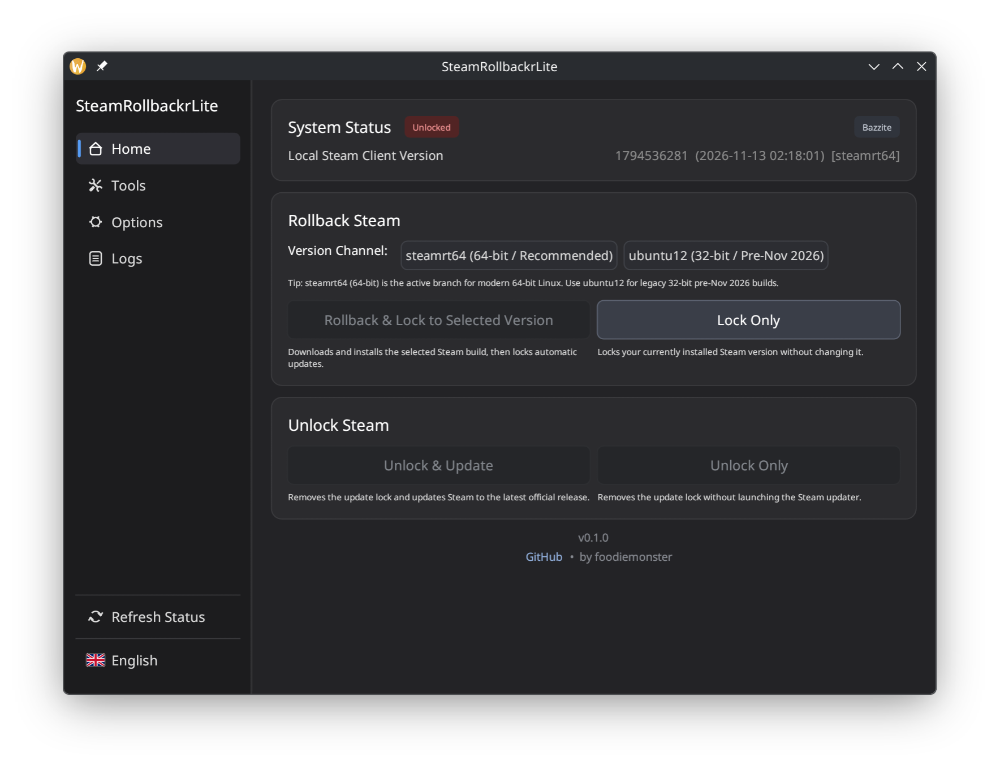

# SteamRollbackrLite

A Linux desktop tool to roll back the Steam client to an earlier version and lock or unlock automatic updates.

Works on most Linux distributions (Bazzite, SteamOS, Mint, Ubuntu, Fedora, Arch) and supports both native and Flatpak Steam installations.



## What It Does

- Shows your **System Status** (Local Steam Client Version, update lock status, distro, and Flatpak detection).
- Lets you select a channel (`steamrt64` 64-bit or `ubuntu12` 32-bit) and pick any previous Steam release from [SteamTracking](https://github.com/SteamTracking/SteamTracking) to **Rollback & Lock Updates**.
- Supports **Lock Current Version**, **Unlock Only**, and **Unlock & Update Steam** to return to the latest official Steam client anytime.
- Supports custom **Steam Path** override if your Steam folder is in a non-standard location.
- **Tools** tab to install or uninstall 32-bit `libcrypto.so.3` (`ubuntu12_32/`).
- **Options** tab to optionally install or uninstall **SteamRollbackrLite** into your application menu (`~/.local/bin/` and `~/.local/share/applications/`), while the AppImage remains fully portable without installation.
- **Troubleshooting** FAQ and **Logs** viewer, plus **Restart Steam** and **Refresh Status** sidebar actions (available in English, Portuguese, and Spanish).

## Installation

Download the package for your system from the [Releases](https://github.com/foodiemonster/SteamRollbackrLite/releases) page.

### Recommended Format by Distro

| Distribution | Recommended Format | Notes |
| --- | --- | --- |
| **SteamOS / Bazzite / Immutable distros** | **AppImage** or **One-Line Installer** | Works without root and survives OS updates. On SteamOS, run in **Desktop Mode**. |
| **Ubuntu / Linux Mint / Debian / Pop!_OS** | **`.deb`** (or **AppImage**) | Double-click `.deb` to install via Software Center. |
| **Fedora / openSUSE** | **`.rpm`** (or **AppImage**) | Double-click `.rpm` to install via Software / Discover. |
| **Arch / EndeavourOS / CachyOS / Manjaro** | **AppImage** or **One-Line Installer** | Installs cleanly without needing `.deb`/`.rpm` tools. |
| **Other Linux distributions** | **AppImage**, **One-Line Installer**, or **Tarball** | Self-contained or user-local (`~/.local/`). |

### AppImage (Recommended — SteamOS, Bazzite, and all distros)
1. Download `SteamRollbackrLite-<version>-x86_64.AppImage`.
2. Right-click the file -> **Properties** -> enable **Executable as Program** (or run `chmod +x SteamRollbackrLite-*-x86_64.AppImage`).
3. Double-click to launch.

### Debian / Ubuntu / Linux Mint (`.deb`)
Download `steamrollbackr-lite_<version>_amd64.deb` and double-click it to install via your Software Center, or run:
```bash
sudo apt install ./steamrollbackr-lite_*_amd64.deb
```

### Fedora / openSUSE (`.rpm`)
Download `steamrollbackr-lite-<version>-1.x86_64.rpm` and double-click it to install via Software / Discover, or run:
```bash
sudo dnf install ./steamrollbackr-lite-*.x86_64.rpm
```

### One-Line Installer (No Root Required)
```bash
curl -fsSL https://raw.githubusercontent.com/foodiemonster/SteamRollbackrLite/main/packaging/web-install.sh | bash
```

### Tarball
1. Download `steamrollbackr-lite-linux-x86_64.tar.gz` from the [Releases](https://github.com/foodiemonster/SteamRollbackrLite/releases) page.
2. Extract and run the installer:

```bash
tar -xzf steamrollbackr-lite-linux-x86_64.tar.gz
./install.sh
```

This installs the binary to `~/.local/bin/steamrollbackr-lite`, the icon to `~/.local/share/icons/hicolor/256x256/apps/steamrollbackr-lite.png`, and the desktop entry to `~/.local/share/applications/steamrollbackr-lite.desktop`.

### Building from Source

```bash
cargo build --release
./install.sh
```

## Usage

1. Open **SteamRollbackrLite** from your application menu (or run `~/.local/bin/steamrollbackr-lite`).
2. **Home:**
   - Override the detected **Steam Path** if needed.
   - Select a channel (`steamrt64` for 64-bit, or `ubuntu12` for 32-bit pre-November 2026 builds) and pick a Steam release from the list.
   - Click **Rollback & Lock Updates** to install that version and prevent Steam from auto-updating, or **Lock Current Version** to lock your current install.
   - When you want to return to the latest official Steam client, click **Unlock & Update Steam** (or **Unlock Only** to remove the lock without running the updater).
3. **Tools & Troubleshooting:** Install or uninstall 32-bit `libcrypto.so.3` in **Tools**, and check the **Troubleshooting** FAQ if anything needs attention.

## Uninstall

```bash
rm -f ~/.local/bin/steamrollbackr-lite \
      ~/.local/share/applications/steamrollbackr-lite.desktop \
      ~/.local/share/icons/hicolor/256x256/apps/steamrollbackr-lite.png
```

If Steam updates are still locked and you want to re-enable them, click **Unlock Updates** before uninstalling (or run `chmod u+w` on your Steam `package/` folder and remove `Steam.cfg` and `steam.cfg`).

## License

MIT
